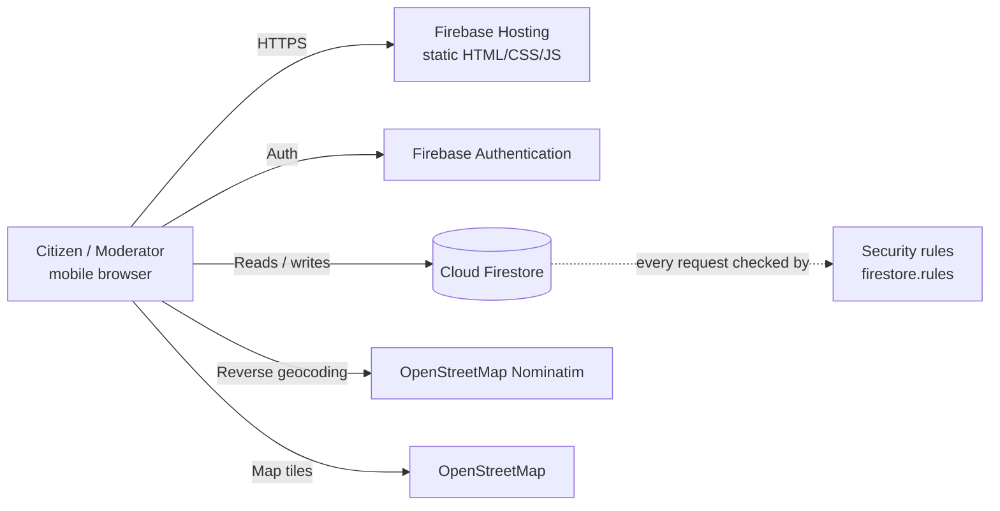

# GreenPulse Sousse

A mobile-first civic web app that lets residents of Sousse (Tunisia) report illegal waste dumping and join local clean-up campaigns created from those reports.

**Live:** https://greenpulse-sousse.web.app

<!-- Add 3–4 screenshots here: home, report flow, moderation, dashboard. -->

## The problem

Illegal dumping in Sousse is visible every day, but there is no simple way for residents to point it out or to organise action together. GreenPulse turns individual reports into collective action:

1. **A citizen reports** a waste site with a photo and its exact location on a map.
2. **A moderator reviews** each report privately: deletes it if it is irrelevant, or **turns it into a clean-up campaign** pre-filled with the report's location.
3. **Residents join the campaign** and act on the ground.
4. **Everyone sees the big picture** on a public dashboard: a density heatmap, the most-reported neighbourhoods and trends over time (no names, no photos).

## Features

| Feature | Details |
|---|---|
| Waste reporting | Two-step flow (photo, then map pin). Photos are compressed in the browser before upload. The neighbourhood is detected automatically from the coordinates. |
| Private moderation | A back-office visible only to moderators: review each report and its photo, delete it, or publish a campaign from it in one step. Access is enforced by Firestore security rules, not just hidden in the UI. |
| Dashboard | Heatmap (Leaflet), KPIs, weekly trend, status breakdown, active citizens per month (Chart.js). |
| Campaigns | Campaigns citizens can join (with capacity limits), finished campaigns kept as a record. Moderators can delete a campaign; if it came from a report, the report returns to the review queue. |
| Authentication | Email and password via Firebase Authentication. |

## Architecture



There is no custom backend: the browser talks directly to Firebase, so **the security rules are the backend's access-control layer**. They are versioned in this repository and covered by automated tests.

### Data model

| Collection | Contents | Who can read |
|---|---|---|
| `users/{uid}` | first name, last name, email | the user only |
| `reports/{id}` | location, neighbourhood, date, status, linked campaign (no names) | all signed-in users, for the public statistics |
| `reportPhotos/{id}` | the compressed photo for report `{id}` | moderators only |
| `campaigns/{id}` | name, place, date, participants, status | all signed-in users |
| `admins/{uid}` | marks a moderator (created by hand) | the user only |

## Design decisions and trade-offs

- **Photos are compressed in the browser and stored in Firestore, in a separate collection.** A phone photo of several MB becomes about 100–300 KB, well below Firestore's 1 MiB document limit, and the project stays on the free plan with no file-storage service to manage. Keeping photos out of `reports` means the dashboard and heatmap download only small documents. The trade-off: this would not scale to large volumes or full-resolution images. At that point, photos should move to object storage (Cloud Storage), with only a URL kept in Firestore.
- **Security lives in the rules, not in the UI.** Hiding the *Modération* button is a convenience; what actually protects data is that Firestore rejects any report change, deletion or campaign creation not made by a moderator. The rules also validate field names, types, sizes and coordinate bounds.
- **Personal data is private by default.** Profiles (name and email) are readable only by their owner. Reports store no names, and photos are visible to moderators only, so the public statistics expose locations and dates, never people.
- **Atomic multi-document writes.** Creating a campaign from a report and linking the report to it happen in one batch, so the two can never get out of sync. Deleting a report removes its photo in the same batch.
- **Server-side counting.** The awareness page counts reports with an aggregation query instead of downloading them.
- **No build step.** Plain ES modules served as static files keep the app simple to deploy and audit, at the cost of no bundling or type checking.

## Security testing

`tests/firestore.rules.test.mjs` runs the rules against the local Firestore emulator. It covers profile privacy, report validation, moderation permissions, photo access and campaign participation. The tests run automatically on every push through GitHub Actions (`.github/workflows/rules-tests.yml`).

```bash
npm install
npm run test:rules   # requires Java 11+ for the Firestore emulator
```

## Real-world use

On 23 August 2026, I organised a clean-up and awareness campaign in the Médina Arbi of Sousse in partnership with AIESEC: 25 young participants, 12 large bags of waste collected. It is recorded in the app as a finished campaign.

## Run and deploy

1. Create a Firebase project with Authentication (email/password) and Firestore enabled.
2. Put your web app configuration in `public/firebase-config.js`.
3. Serve locally: `npx firebase emulators:start --only hosting`
4. Deploy: `npx firebase deploy --only hosting,firestore:rules`
5. To make someone a moderator, create a document `admins/{their uid}` in the Firebase Console.

## Limitations and next steps

- Moderators are designated manually; there is no admin management screen yet.
- Citizens are not notified when their report becomes a campaign.
- No automated UI tests yet; only the security rules are tested.
- Planned: automatic waste-type classification of report photos with a machine-learning model, with a measured evaluation.

## Tech stack

HTML, CSS, JavaScript (ES modules) · Firebase Hosting, Authentication, Cloud Firestore · Leaflet and Leaflet.heat · Chart.js · OpenStreetMap / Nominatim · Node.js test runner, @firebase/rules-unit-testing · GitHub Actions
